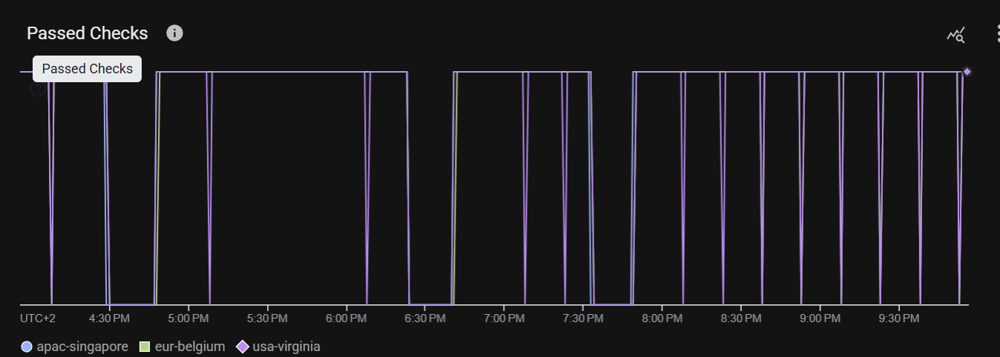

# Self-Managed Kubernetes Disaster Recovery

Recover a stateful service after losing a region. This lab runs Gitea and PostgreSQL on a kubeadm-built Kubernetes cluster on VMs. Recovery rebuilds the cluster from code, restores application data from an offsite backup, and measures downtime and data loss.

Three drills on 2026-10-04 stopped the primary region (Finland) and recovered the service in Belgium in under 20 minutes, against a target of four hours. Milestones 0 to 10 in [plan.md](plan.md) passed their gates. Milestone 8 rebuilt the environment from the runbooks, milestone 9 removed the backup downtime, and milestone 10 automated the recovery. The planned milestones measure the recovery unattended, shorten it, keep the recovery writes on the return, and close the recovery gaps of the lab; [plan.md](plan.md) gives their order.

The lab models organizations that must run Kubernetes on VMs they control. [Production readiness](docs/production-readiness.md) lists what a production deployment adds. [Milestone 14](plan.md#14-close-the-recovery-gaps-of-the-lab) closes the gaps that weaken recovery.

## Results

| Measure | Drill 1 | Drill 2 | Drill 3 | Target |
| --- | --- | --- | --- | --- |
| Recovery time | 19 min 17 s | 17 min 36 s | 16 min 46 s | At most 4 hours |
| Data loss | 25 min 28 s | 15 min 16 s | 10 min 10 s | At most 2 hours |
| Backup interval | 60 min | 60 min | 15 min | |
| Failed steps | One check rerun | None | None | |

Recovery time runs from the first failed external probe until sign-in, a known commit and issue, and a new push work through `git.sindrg.com`. Data loss runs from the last acknowledged write to the newest restored write. [Decision 0002](docs/decisions/0002-recovery-contract.md#measurement) defines both.

What the numbers do not show:

- **The drills were attended.** An operator ran the steps and checked the result between them. Since [milestone 10](plan.md#10-automated-recovery), one GitHub Actions workflow runs every step and its check, and a scheduled watchdog can start it ([decision 0013](docs/decisions/0013-automated-recovery.md)). A full run from the workflow took 17 min 07 s on 2026-10-17. Detection by the watchdog has not been measured; [milestone 12](plan.md#12-unattended-drills) measures it.
- **Most of the time is the cluster build.** The restore Job takes under 30 seconds. [Milestone 11](plan.md#11-faster-cluster-build) builds nodes from a prepared image.
- **Each backup in the drills paused the service.** A backup briefly scaled Gitea to zero, four times an hour. [Decision 0014](docs/decisions/0014-snapshot-backups.md) replaces this with a capture from an LVM snapshot while Gitea keeps running. [Milestone 9](plan.md#9-backups-without-downtime) verified it on the primary.
- **Cost was not read from billing.** The recovery environment existed for 42, 28, and 23 minutes. No milestone measures drill cost.

The external uptime check during the three drills, in UTC+2. The wide gaps are the outages and the narrow dips are backups:

## Architecture

The recovery region has no running VMs until a drill. Terraform state, deployment source, backup storage, and recovery credentials remain available if the primary region is unavailable. The backup includes PostgreSQL data and Gitea repositories and configuration as one consistent recovery point.

## Tools and responsibilities

| Tool | Responsibility |
| --- | --- |
| Terraform | VM, network, load balancer, and backup infrastructure |
| Ansible and kubeadm | VM configuration, Kubernetes bootstrap, and the add-ons Flux depends on |
| Flux and Helm | Deploy and reconcile the application layer from GitHub: cert-manager, PostgreSQL, Gitea, backups, monitoring, and network policies |
| Traefik and cert-manager | Route HTTPS through the Gateway API with Let's Encrypt certificates |
| SOPS and age | Keep secrets encrypted in the public repository; encrypt backups to keys the cluster does not hold |
| PostgreSQL and Gitea | Stateful service used to prove recovery |
| Offsite object storage | Encrypted application backups every 15 minutes, with a Healthchecks.io heartbeat that alerts when they stop |
| Grafana Cloud | Cluster metrics that stay readable after the primary region is lost |
| GitHub Actions | Tests and linters, a weekly check that pinned downloads still exist, a daily scan of the public surface, the recovery and return workflows, which sign in to Google Cloud without a stored key, and the watchdog that starts a recovery |
| External health probe | Measure outage and restored service from outside the cluster |

## Documentation

| To find | Read |
| --- | --- |
| Drill results, timelines, and failures | Worklogs [6](docs/worklogs/06-disaster-drill.md) and [7](docs/worklogs/07-faster-recovery.md) |
| The recovery procedure | [Regional recovery runbook](docs/runbooks/regional-recovery.md) |
| How each part works, with diagrams | [Architecture pages](docs/architecture/README.md) |
| Why it is built this way | [Decision records](docs/decisions/) |
| How to build it yourself | [Reproduce the project](docs/reproduce.md) |
| Everything else | [Documentation index](docs/README.md) |

Run `make` to list the operator commands.

## License

[MIT](LICENSE).
