# 9. Backup and restore

Every 15 minutes a CronJob captures the database and the Gitea volume as one consistent set, encrypts it, and uploads it to a bucket in another region. A restore Job reverses it. This is the only path by which data leaves the primary region.

## Backup

The CronJob `gitea-backup` runs at minutes 7, 22, 37, and 52 of every hour on the worker ([decision 0012](../decisions/0012-backup-every-15-minutes.md)). It captures from one LVM snapshot of the worker data volume, so Gitea and PostgreSQL keep running ([decision 0014](../decisions/0014-snapshot-backups.md)).


PostgreSQL and the Gitea volume are both Local Path Provisioner directories on one filesystem, so one snapshot holds both at the same instant. That is what makes the set consistent. The [storage role](02-ansible.md) puts that filesystem on the logical volume `k8sdr/data` and leaves 20% of the volume group free for the snapshot.

Each container of the backup Pod runs one step of `backup.sh`:

| Container | Runs as | Step |
| --- | --- | --- |
| `snapshot` | root, privileged | Native sidecar. Runs `/usr/local/sbin/k8sdr-snapshot create` in the worker's mount and IPC namespaces, through the worker's `/proc`. The command removes a snapshot left by an earlier run, creates `k8sdr/backup`, mounts it, and binds the PostgreSQL and Gitea volume directories below `/var/lib/k8s-dr-backup`. On `SIGTERM` it removes the snapshot. |
| `dump-postgresql` | 999 | Starts PostgreSQL on the snapshot's data directory with no network listener. The server recovers from its write-ahead log as after a power loss, then `pg_dump` reads it. |
| `archive-gitea` | 1000 | Archives the Gitea volume from the snapshot. |
| `backup` | 1000 | Uploads both archives and the manifest, and pings success. |

The set name is the UTC time the snapshot was taken. If any step fails, it pings the failure endpoint, the Pod fails, and the sidecar removes the snapshot. A retry is not attempted; the next scheduled run is the retry.

## A backup set

```text
primary/20260929T170701Z/
  postgresql.dump.age
  gitea-data.tar.gz.age
  manifest.json
```

The prefix is the cluster name from the [cluster settings](04-flux.md#per-cluster-settings), so the primary writes under `primary/` and a recovery cluster under `recovery/`. The set name is its UTC snapshot time. `manifest.json` lists each file's SHA-256 and size and is written last, so a set without a manifest is incomplete and a restore ignores it. It also records `pause_seconds`, which is `0` since decision 0014, and `capture: "lvm-snapshot"`.

## Encryption

Each archive is encrypted to two age public keys before it leaves the pod: a backup key kept with the recovery credentials, and an offline key. The cluster holds only the public keys, so a compromised cluster cannot read old backups.

## The bucket

| Control | Effect |
| --- | --- |
| Location | Belgium, outside the primary region |
| Writer access | Each cluster's worker service account can create objects only under its own prefix. It cannot delete or overwrite. |
| Reader access | Clusters can read every prefix, so a recovery cluster can restore the primary's sets |
| Retention | 14 days, during which no one can delete a set without first removing the policy |
| Versioning and soft delete | On; soft delete keeps removed objects for 7 days |

The Job gets its token from the metadata server. No service account key exists.

### Fencing

After a failover, the operator disables the primary worker's service account. A primary that comes back can then no longer write backups, and a restore never has to choose between two clusters' sets under one prefix. `infra/shared` ignores the account's `disabled` flag, so a later apply does not lift the fence.

## Alerting

Healthchecks.io expects a success ping every hour with one hour of grace. It alerts when pings stop or a failure ping arrives, which is when no backup has completed inside the two-hour data-loss target. The period did not change with the 15-minute schedule.

## Restore

`make restore RESTORE_NAMESPACE=<namespace>` runs a Job with the backup image under its own service account, `gitea-restore`. Its Role can scale the Gitea Deployment and its network policy reaches PostgreSQL; the backup has neither.



Everything above the scale-down changes nothing, so a wrong key or a damaged set fails while the current data is intact. After the first destructive step, a failure leaves Gitea stopped so that nothing serves a partial restore.

The backup age private key is sent from the operator machine into a Secret that exists only while the Job runs. The playbook suspends the backup CronJob for the duration and deletes the Secret afterwards, even on failure.

The namespace has no default. `gitea` replaces a live service; `gitea-restore` is a test copy. A restore reads the `primary/` prefix by default, whichever cluster runs it, which is what a recovery cluster needs.

## Test restores

`make restore-test-env` creates `gitea-restore` and `postgresql-restore` on the same cluster from the same manifests, without the public Gateway or the backup CronJob. A restore into it, followed by the fixture checks through a port-forward, proves a set restores without touching the live service. The first test restore took 43 seconds.

## Limits

- The backup bucket is in the same project as the cluster.
- The retention policy is unlocked.
- Test restores are run by hand, not on a schedule.
- The capture is crash-consistent, not quiesced. A push whose refs are written but whose database update is not yet committed at the snapshot instant restores without that update.
- The backup Pod holds a privileged container that can act as root on the worker.
- If more than the free 20% of the volume group is written while a snapshot exists, the snapshot becomes invalid and that backup fails. The data volume is not affected.

A recovery cluster starts with its backups suspended, so a bootstrap writes no set before the restore is verified. A change in Git enables them after the cutover, and its sets land under `recovery/`. See [decision 0008](../decisions/0008-cold-recovery.md#amendment-recovery-backups-stay-suspended-until-the-cutover).

See decisions [0007](../decisions/0007-consistent-backups.md) and [0014](../decisions/0014-snapshot-backups.md), the [backup and restore runbook](../runbooks/backup-restore.md), and the [snapshot backups runbook](../runbooks/snapshot-backups.md).
